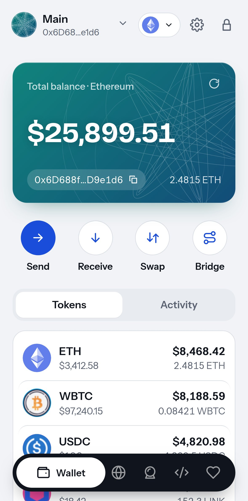
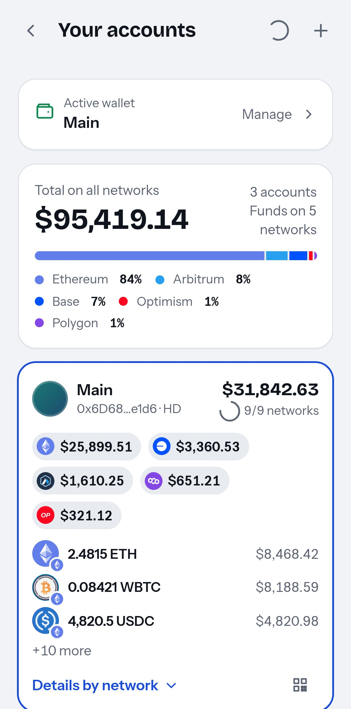
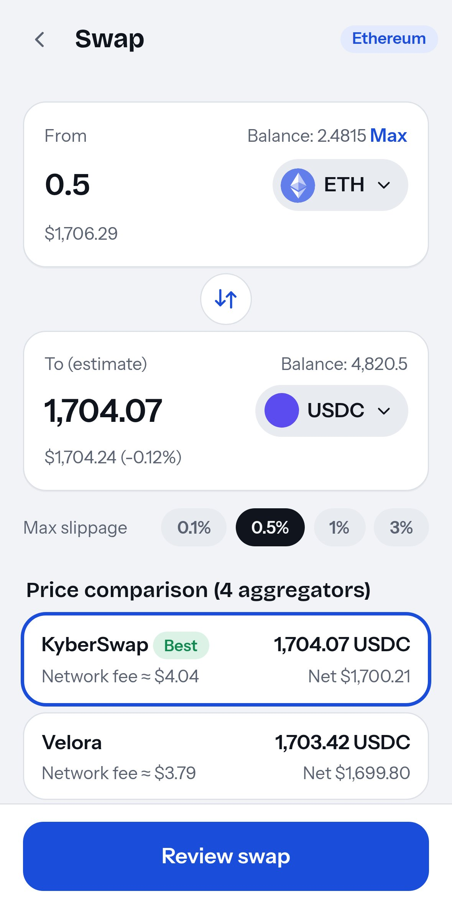
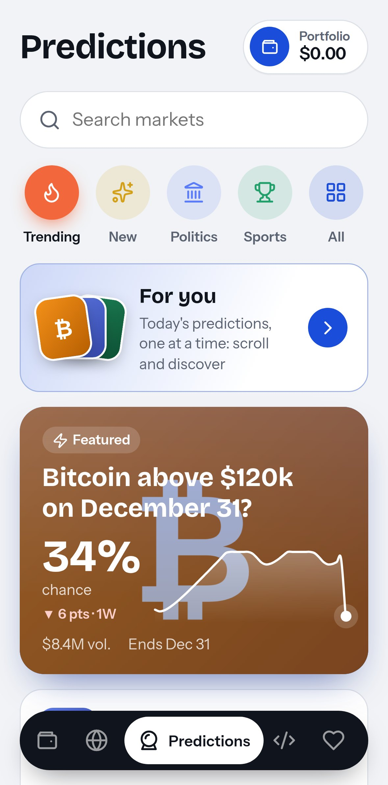

<p align="center">
  
</p>

<h1 align="center">Chakra</h1>

<p align="center">
  A self-custodial wallet for Ethereum and every major EVM network, TON, Solana, Tron and Bitcoin.<br>
  Browser extension for Chrome and Firefox, and an app for Android.
</p>

<p align="center">
  <a href="https://github.com/ChakraWallet/ChakraWallet/actions/workflows/build.yml"></a>
  <a href="https://github.com/ChakraWallet/ChakraWallet/actions/workflows/e2e.yml"></a>
  <a href="https://github.com/ChakraWallet/ChakraWallet/actions/workflows/landing.yml"></a>
  <a href="LICENSE"></a>
  <a href="https://chakrawallet.dev"></a>
</p>

<p align="center">
  
  
  
  
</p>

## Highlights

- **Your keys stay on your device**, encrypted with one password (PBKDF2-SHA256 600k + AES-256-GCM), with fingerprint unlock on Android. Several separate wallets, each with its own recovery phrase.
- **Every balance at a glance**: all your accounts, networks and tokens in one place, found automatically, with their value and a spam filter.
- **Best-price swaps and bridges**: KyberSwap, Velora, OpenOcean and LI.FI for swaps, LI.FI, Relay, Across and deBridge for bridges, ranked by what you actually receive after fees. Approvals for the exact amount only, MEV protection with Flashbots and Jito.
- **Dapps everywhere**: EIP-6963 and `window.ethereum` in the extension, a multi-tab dapp browser in the Android app, WalletConnect and TON Connect for sites on other devices.
- **Scam protection**: address-poisoning fakes and spam tokens hidden, transactions decoded and unlimited approvals flagged before you sign.
- **And more**: NFTs, prediction markets, MetaMask Card on Base, smart contracts (deploy and call), vanity addresses, an encrypted one-line backup.
- **7 languages**: English, Italian, Spanish, French, German, Russian and Chinese.
- **No servers, no extra fees, no tracking**: Chakra talks only to public nodes, indexers and aggregators.

The full list is in [docs/features.md](docs/features.md).

## Build

Requirements: Node.js 22+; for Android also JDK 21 and the Android SDK.

```
npm install
npm run build                                                    # extensions: dist/chrome, dist/firefox (+ zips)
JAVA_HOME=/path/to/jdk ANDROID_HOME=/path/to/sdk npm run android   # dist/chakra-android-debug.apk
```

`npm run android -- --release` builds the release APK, signed when `ANDROID_KEYSTORE_FILE`, `ANDROID_KEYSTORE_PASSWORD`,
`ANDROID_KEY_ALIAS` and `ANDROID_KEY_PASSWORD` are set. On GitHub, [build.yml](.github/workflows/build.yml) builds
everything at every push to `master` and attaches the files to the release on `v*` tags (secrets: the same names, with
the keystore in base64 as `ANDROID_KEYSTORE_BASE64`).

## Install from source

- **Chrome, Edge, Brave**: `chrome://extensions` → *Developer mode* → *Load unpacked* → `dist/chrome`.
- **Firefox 128+**: `about:debugging#/runtime/this-firefox` → *Load Temporary Add-on* → `dist/firefox/manifest.json`.
  For a permanent install, sign it for free on [addons.mozilla.org](https://addons.mozilla.org/developers/) as *Unlisted*.
- **Android**: `adb install dist/chakra-android-debug.apk`.

## Development

- `npm run watch` rebuilds at every change (then reload the extension).
- `npm test` runs the unit tests in `tests/` and the translation check; `npm run test:unit -- vault` only the matching files.
- `npm run e2e` sends, swaps and bridges through the real interface on local EVM and TON networks ([e2e/README.md](e2e/README.md)).
- Every family of networks plugs into the same screens through a chain driver: see [docs/adding-a-chain.md](docs/adding-a-chain.md).

<details>
<summary>Project structure</summary>

```
src/background/     encrypted vault, dapp provider, approvals, signing and sending
src/inpage.js       window.ethereum + EIP-6963 (in the page)
src/content.js      page ↔ background bridge
src/mobile/         Android runtime (Capacitor): extension API shim, in-app browser bridge
src/shared/         networks, RPC, fees, balances, history, prices, swaps, i18n
src/shared/locales/ dictionaries (en = base and fallback)
src/ui/             interface (Preact): popup, screens, approvals
src/ui/chains/      chain drivers (EVM here; TON, Solana, Tron and Bitcoin in src/ui/ton, solana, tron, btc)
android/            Capacitor Android project (native plugins: dapp browser, fingerprint, system bars)
landing/            the website, chakrawallet.dev
tests/, e2e/        unit and end-to-end tests
scripts/            Android build, icon renderer, i18n checker
build.mjs           build for Chrome, Firefox and Android + icons + zips
```

</details>

## Support the project

Chakra is free, open source and adds no fees. If you find it useful, you can send anything you like — any token,
any amount, even one without value — to one of these addresses (they are the same as in the app's Support tab):

| Network | Address |
|---|---|
| Ethereum and every EVM network (Base, Arbitrum, Optimism, Polygon, BNB Chain…) | `0x27C94EC37Dfc9a5E8799A84DEb3c4BFfDE5bA027` |
| Bitcoin | `bc1qk3cunk9nu5dh69kkfwae67vgqsa3v2mlrjtzn8` |
| Solana | `8D2TB25Q99dqjewGtMjUJMfMsWrUxTHqsj8fnA7CjVK7` |
| TON | `UQCHxPljAvQzsVeZ-V142TGoxKACyUksrBoJVV75llxGqZ3q` |
| Tron | `TKvTRueHpsf1RsjCCRm87qdxG45DVMfKVK` |

Nothing is unlocked in return: it's a thank-you, nothing more. A ⭐ on GitHub helps too.

## License

[Apache License 2.0](LICENSE)
